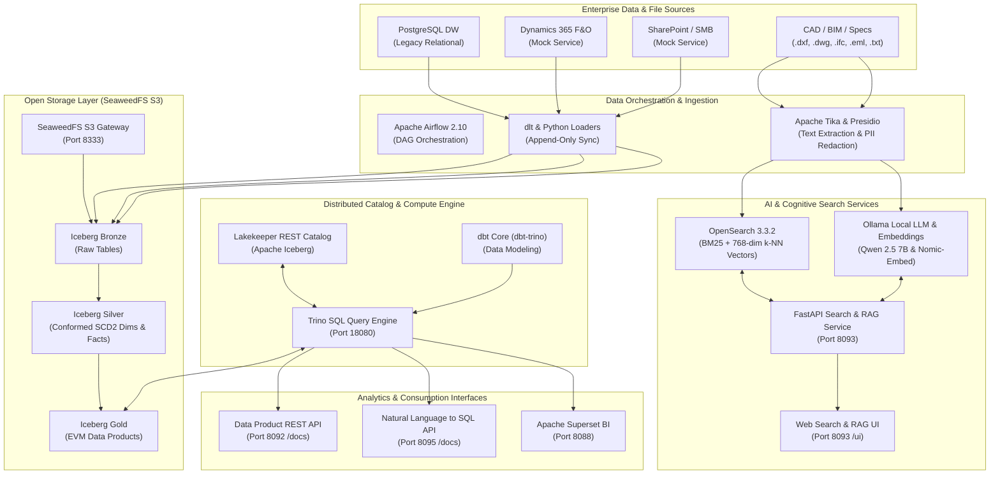

# Dar Al-Handasah — Data Lakehouse & AI Engineering Pilot

> **Engineering & Project Management Consultancy — Phase 1 Pilot**  
> 100% OSI-licensed core stack · Apache Iceberg Medallion Lakehouse · Grounded Engineering Search & RAG · Single Laptop / Workstation Ready

---

## 🏛️ Architecture Overview



---

## 🚀 Quick Start (Single-Command Entrypoint)

All operations are managed via the automated PowerShell script `.\dar.ps1`:

```powershell
# 1. Start all containers (creates .env, pre-flights ports, provisions network)
.\dar.ps1 up

# 2. Seed data (DW legacy schema, bronze ingestion, dbt models, OpenSearch indexing, Superset)
.\dar.ps1 seed

# 3. Check health across all 34 functional probes
.\dar.ps1 health

# 4. Run the automated end-to-end demo runner
.\dar.ps1 demo
```

---

## 🌐 Service Ports & Web Interfaces

| Service Name | Web URL | Credentials / Notes | Purpose |
|---|---|---|---|
| **Engineering Search & RAG UI** | http://localhost:8093/ui | Persona Switcher | Hybrid CAD/BIM/Doc Search & Grounded Q&A |
| **Search & RAG REST API** | http://localhost:8093/docs | None (FastAPI Swagger) | Programmatic Search & Citation RAG API |
| **Data Product REST API** | http://localhost:8092/docs | Keycloak Bearer Token | Portfolio Health & EVM REST Endpoints |
| **Natural Language to SQL API** | http://localhost:8095/docs | None (FastAPI Swagger) | Self-service NL2SQL with SQLGlot AST guard |
| **Apache Superset BI** | http://localhost:8088 | `admin` / `.env` password | Executive EVM & Cost/Budget Dashboards |
| **Trino Distributed Query** | http://localhost:18080 | `admin` (no password) | SQL interface across Iceberg tables |
| **Lakekeeper Iceberg Catalog** | http://localhost:8181 | None (Dev REST catalog) | Iceberg REST catalog endpoint |
| **OpenSearch Dashboards** | http://localhost:5601 | `admin` / `DarLakehouseAdmin123!` | Vector index explorer & audit visualization |
| **Apache Airflow** | http://localhost:8079 | `admin` / `.env` password | Ingestion & transformation pipeline DAGs |
| **Keycloak IAM** | http://localhost:8444 | `admin` / `.env` password | Identity provider & SSO tokens |
| **SeaweedFS S3 Gateway** | http://localhost:8333 | S3 keys from `.env` | S3-compliant object store |
| **Prometheus / Grafana** | http://localhost:3002 | `admin` / `.env` password | Infrastructure & pipeline observability |

---

## 🧪 Acceptance & Quality Assurance Gates

Run verified automated test suites directly through `dar.ps1`:

```powershell
# Run Use Case 1 Search, Ingestion & RAG Gates (9 tests)
.\dar.ps1 smoke-uc1

# Run Use Case 2 Lakehouse Migration, EVM & Reconciliation Gates (12 tests)
.\dar.ps1 smoke-uc2

# Run NL2SQL 10-query semantic suite and mutation block guard
docker run --rm --network dar-lakehouse_default --env-file .env -e NL2SQL_URL=http://dar-nl2sql:8000 -v "${PWD}:/repo" -w /repo python:3.11-slim bash -lc "pip install pytest requests && pytest -v tests/uc2/test_nl2sql_suite.py"

# Verify RFP Requirements Traceability (97 requirements parsed from Excel)
.\dar.ps1 traceability

# Code and Branding Linting
.\dar.ps1 lint
```

---

## 🔍 Data Authenticity & Disclosure

- **Real Engine Stack:** OpenSearch 3.3.2, Apache Iceberg, Lakekeeper, Trino 455, Apache Tika, ezdxf, Microsoft Presidio, and Ollama (`qwen2.5:7b-instruct-q4_K_M` + `nomic-embed-text`) are active production containers.
- **Synthetic Test Corpora:** 
  - Enterprise ERP (Dynamics 365) and SharePoint document stores are mocked via standalone HTTP services (`dar-d365-mock`, `dar-sharepoint-mock`) returning realistic payloads.
  - Legacy PostgreSQL DW is seeded with synthetic projects P001–P005 matching Dar Al-Handasah project hierarchy, timesheets, and budgets.

---

## 🛠️ Troubleshooting & Prerequisites

### Prerequisites
- **Operating System:** Windows 10/11 with WSL2 or Linux (Ubuntu 22.04+).
- **RAM:** Minimum 16 GB assigned to Docker/WSL (`.wslconfig`).
- **Storage:** 20 GB free disk space.
- **Docker Desktop:** Ensure WSL2 engine is enabled.
- **Virtual Memory:** OpenSearch requires `sysctl -w vm.max_map_count=262144`.

### Troubleshooting
1. **Port conflicts on Windows:**
   - Run `.\dar.ps1 up-lite` to run only core, UC1, and UC2 containers without auxiliary observability/CI-CD containers.
2. **Ollama connection or slow response:**
   - Pre-warm the model by querying `.\dar.ps1 demo`. Ollama automatically keeps the model weights loaded in system RAM.
3. **Resetting to clean state:**
   ```powershell
   .\dar.ps1 reset -Force
   .\dar.ps1 up
   .\dar.ps1 seed
   ```
